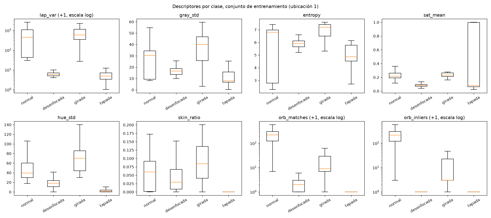

# 5. Módulo 1: procesamiento clásico

El módulo clásico calcula un vector de descriptores matemáticos por imagen y decide la clase con un árbol de
reglas cuyos umbrales se calibran con el conjunto de entrenamiento. Código: `src/features.py` (descriptores),
`src/classic.py` (reglas) y `src/evaluate_classic.py` (evaluación).

## 5.1 Preprocesamiento

Cada imagen se reduce a 640×360 y se convierte a escala de grises y a HSV. La nitidez se mide **sin suavizado
previo**: un experimento mostró que el suavizado gaussiano (3×3 o 5×5) no protege la regla del ruido y sí reduce
el margen entre clases (sección 5.6). Los filtros lineales y no lineales (gaussiano, mediana, bilateral) se usan
como **correcciones** ante perturbaciones, donde los experimentos muestran que sí hacen falta (sección 9).

## 5.2 Descriptores

| Descriptor | Qué mide | Definición | Sabotaje que delata |
|---|---|---|---|
| `lap_var` | Nitidez | Varianza de la respuesta del Laplaciano (segunda derivada) sobre la imagen en gris | Desenfoque y tapa: sin bordes, la varianza cae |
| `gray_std` | Contraste | Desviación estándar de los niveles de gris | Tapa: imagen casi uniforme |
| `entropy` | Información del histograma | H = −Σ pᵢ log₂ pᵢ sobre los 256 niveles de gris | Tapa: pocos niveles ocupados |
| `sat_mean` | Saturación media | Media del canal S de HSV, entre 0 y 1 | Tapa de un color intenso |
| `hue_std` | Variedad de colores | Desviación estándar **circular** del matiz, en grados, sobre los píxeles con color (S ≥ 40 y V ≥ 40): √(−2 ln R), con R la longitud media de los vectores unitarios de matiz | Tapa: un solo color o ningún color |
| `skin_ratio` | Tono de piel | Proporción de píxeles con matiz entre 0° y 50° y saturación y brillo en rango de piel | Mano tapando la cámara |
| `orb_matches` | Misma escena | Coincidencias ORB (1000 puntos, distancia de Hamming, razón de Lowe 0,75) contra 8 referencias de la misma cámara; se toma la mejor | Giro y cambio de escena: pocas coincidencias |
| `angle` | Giro de la cámara | Ángulo de una transformación de similaridad estimada con RANSAC entre los puntos ORB y los de la mejor referencia; solo si la apoyan al menos 6 puntos consistentes | Giro parcial: misma escena, vista girada |

El matiz es un ángulo: 2° y 358° son casi el mismo rojo. Una desviación estándar ordinaria los vería a 356° de
distancia; la circular los ve a 4°. Por eso `hue_std` usa estadística circular.



**Figura 5.1.** Descriptores por clase en el conjunto de entrenamiento de la ubicación 1. Fuente:
`results/figuras/descriptores_por_clase.png`.

Lectura de la figura 5.1:

- `lap_var` separa en dos grupos: normales y giradas (nítidas, medianas de cientos) frente a desenfocadas y
  tapadas (medianas cercanas a 5).
- `hue_std` separa tapadas de desenfocadas: la tapa tiene casi un solo color.
- `orb_matches` separa la normal de todo lo demás: una escena que no coincide con las referencias está saboteada.
- `skin_ratio` vale 0 en todas las tapadas de Bremen: en este dataset las cámaras se taparon con objetos, no con
  manos. Por eso no entra en las reglas; queda para la captura propia, donde se tapa con la mano.

## 5.3 Árbol de reglas

```
coincidencias ORB ≥ match_min y |ángulo| ≤ angle_max   → normal
coincidencias ORB ≥ match_min y |ángulo| >  angle_max   → girada (misma escena, vista girada)
coincidencias ORB ≥ match_min sin ángulo confiable      → girada (coincidencias sin geometría consistente)
si no, lap_var < blur_max:  hue_std < cover_threshold   → tapada; si no → desenfocada
si no                                                   → girada (imagen nítida de otra escena)
```

El orden sigue la lógica del problema: primero se pregunta si la cámara sigue viendo su escena (ORB y ángulo); si
no, si la imagen perdió los bordes (Laplaciano); y entre las que perdieron bordes, si queda variedad de color
(matiz). Las reglas cubren los elementos de la rúbrica: descriptores matemáticos (Laplaciano, entropía, ORB),
transformación geométrica (similaridad con RANSAC) y umbralización de color (matiz en HSV).

## 5.4 Umbrales calibrados

Cada umbral se elige **solo con el conjunto de entrenamiento** de la ubicación 1, sin las 8 imágenes de
referencia, que coincidirían consigo mismas. El valor es el punto medio entre dos valores observados que maximiza
la **exactitud balanceada** de su decisión, para que la clase pequeña pese igual que la grande.

**Tabla 5.1.** Umbrales. Fuente: `results/clasico/umbrales.json`.

| Umbral | Valor | Cómo se calibra | Interpretación |
|---|---|---|---|
| `match_min` | 12,5 | Normal frente al resto, con `orb_matches` | Con 12 coincidencias o menos, la escena ya no es la normal |
| `blur_max` | 18,86 | Desenfocada y tapada frente a girada, con `lap_var`, solo entre saboteadas | Por debajo, la imagen no tiene bordes nítidos |
| `cover_feature` | `hue_std` | El mejor de 5 candidatos (`hue_std`, `gray_std`, `entropy`, `sat_mean`, `lap_var`) | El color, no el brillo, separa una tapa de un desenfoque |
| `cover_threshold` | 5,40° | Tapada frente a desenfocada | Menos de 5,4° de dispersión del matiz: un solo color o ningún píxel con color |
| `angle_max` | 0,94° | Percentil 99 del \|ángulo\| de las normales de entrenamiento que sí coinciden | Lo máximo que se mueve una cámara normal (viento, vibración) |

**Por qué `hue_std` y no `gray_std` para la tapa.** Era la hipótesis inicial (una tapa es uniforme), pero en los
datos reales `gray_std` no separa una tapa de una escena nocturna, que también es oscura y poco contrastada. El
matiz sí: de noche la escena conserva colores distintos (luces, señales) y la tapa no. El calibrador lo eligió
entre 5 candidatos con la misma métrica.

## 5.5 Puntaje continuo para la curva ROC

Unas reglas solo dan etiquetas, y la curva ROC necesita un puntaje. Se define

  puntaje = max( match_min / (match_min + coincidencias), |ángulo| / (|ángulo| + angle_max) )

entre 0 y 1. La parte del ángulo vale 1 cuando no hay un ángulo confiable. Cada parte vale exactamente 0,5 en su
umbral, así que puntaje > 0,5 equivale a la decisión "saboteada" de las reglas. Se verificó en 500 filas
aleatorias en las pruebas y en las 2609 filas reales de la ubicación 1.

## 5.6 Experimento: suavizado y ruido en el Laplaciano

Exactitud balanceada para separar imágenes borrosas (desenfocadas y tapadas) de nítidas, con 60 imágenes de
entrenamiento por clase y el umbral aprendido sin ruido. Fuente: `docs/clasico.md`, sección 7.

**Tabla 5.2.** Efecto del suavizado previo.

| Variante | Sin ruido | Con ruido gaussiano (σ = 15) |
|---|---|---|
| Laplaciano sin suavizar | 0,996 (umbral 17,5) | 0,500 |
| Gaussiano 3×3 | 1,000 (umbral 2,9) | 0,500 |
| Gaussiano 5×5 | 0,979 (umbral 2,2) | 0,500 |

Ningún suavizado gaussiano protege la regla: el ruido crea bordes falsos, el Laplaciano sube y una imagen borrosa
parece nítida. Sin ruido, el Laplaciano sin suavizar deja más margen (umbral 17,5 frente a 2,9, muy cerca de 0).
Este fallo se diagnostica y se corrige en la sección 9.

## 5.7 Comparación de detectores: ORB, SIFT y KAZE

Para cada detector, con la configuración de la clase 11 (ORB: Hamming y razón 0,75; SIFT y KAZE: L2 y razón
0,7), se calibra el umbral de coincidencias que separa normales de saboteadas con 50 imágenes de entrenamiento por
clase y se evalúa en todo el conjunto de validación (la prueba no se usa).

**Tabla 5.3.** Comparación de detectores en validación. Fuente: `results/clasico/comparacion_descriptores.csv`.

| Detector | Exactitud balanceada | Falsas alarmas | Giradas detectadas solo por coincidencias | AUC | Emparejamiento por cuadro |
|---|---|---|---|---|---|
| **ORB** | 0,948 | 0,5 % | 3 de 18 | **0,998** | **1,3 ms** |
| SIFT | 0,961 | 0 % | 6 de 18 | 0,988 | 18,6 ms |
| KAZE | 0,948 | 0,5 % | 3 de 18 | 0,986 | 67,8 ms |

Con imágenes limpias, ORB separa igual que SIFT y KAZE y es 14 y 51 veces más rápido. La ventaja de SIFT (3
giradas más de 18) no es significativa. Se mantiene ORB, como recomienda la clase 11 para tiempo real. Las giradas
se detectan sobre todo con la regla del ángulo, no solo con las coincidencias.

## 5.8 Línea base aprendida: KNN, SVM y Naive Bayes

Para saber cuánto aportan las reglas escritas a mano, se entrenaron tres clasificadores de la clase 20 sobre **el
mismo vector de descriptores**: KNN, SVM y Naive Bayes. Los hiperparámetros se eligieron con validación cruzada de
5 pliegues **agrupada por bloques de tiempo** y solo en entrenamiento; un K-fold aleatorio pondría fotos casi
idénticas a los dos lados. Los resultados se comparan en la sección 7.3. Detalle en `docs/ml_clasico.md`.
