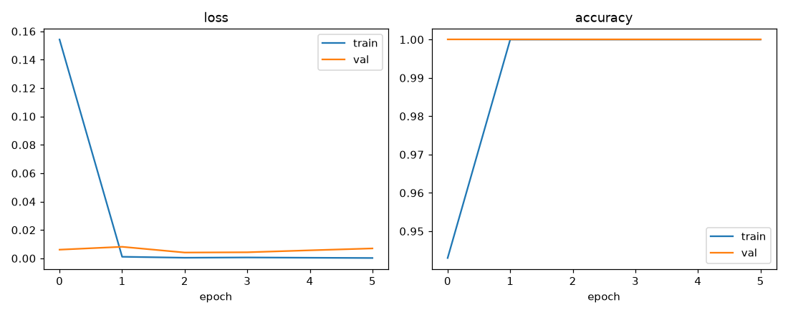
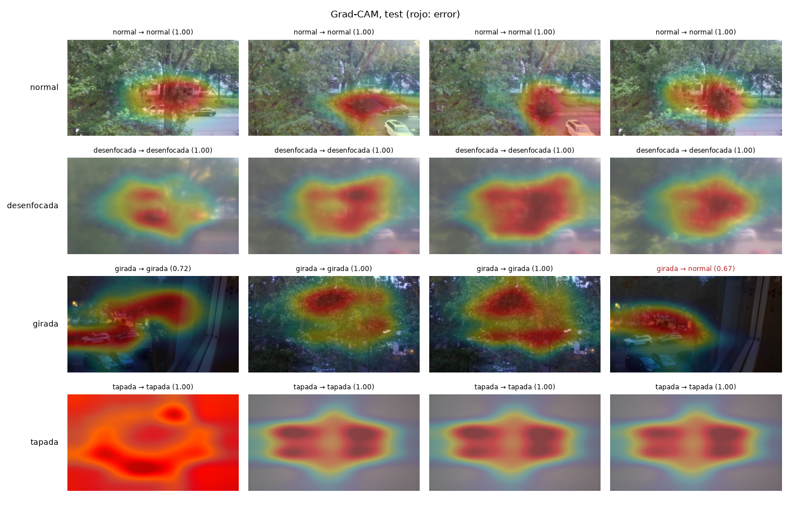

# 6. Módulo 2: aprendizaje profundo

El módulo profundo es una red convolucional preentrenada (MobileNetV2 [13]) con una cabeza nueva de 4 clases. Código:
`src/cnn.py` (modelo), `src/train_cnn.py` (entrenamiento), `src/evaluate_cnn.py` (evaluación) y `src/explain_cnn.py`
(Grad-CAM). El detalle completo, con las fórmulas de tamaño y de parámetros por capa, está en `docs/cnn.md`.

## 6.1 Arquitectura

- **Base:** MobileNetV2 preentrenada en ImageNet [15], entrada de 224×224 en RGB escalada a [−1, 1]. Usa bloques
  residuales invertidos y convoluciones separables (depthwise y pointwise) [13][16].
- **Cabeza:** pooling global, Dropout 0,2 y una capa densa de 4 salidas con softmax (normal, desenfocada, girada,
  tapada).
- **Pérdida y optimizador:** entropía cruzada categórica y Adam. Los pesos por clase están balanceados, porque la
  clase girada tiene solo 84 imágenes de entrenamiento frente a 1120 normales.

**Tabla 6.1. Parámetros** (coinciden con `model.summary()` y están fijados por pruebas en `tests/test_cnn.py`).

| Parte | Parámetros | Estado |
|---|---|---|
| Base MobileNetV2 sin la cabeza de ImageNet | 2 257 984 | congelada |
| Cabeza: 1280 × 4 + 4 | 5 124 | entrenables |
| Total | 2 263 108 | |

**La base se congela.** Solo se entrena el 0,23 % del modelo: entrenar la cabeza equivale a un clasificador lineal
sobre 1280 descriptores ya aprendidos. Con 1930 imágenes de entrenamiento, ajustar 2,3 millones de parámetros sería
sobreajustar. Descongelar las últimas 10 capas se probó y no mejoró (sección 6.3).

**Por qué MobileNetV2 y no ResNet-50 o VGG-16.** La demo en vivo corre en un portátil sin GPU. Medido con la cabeza
completa de ImageNet, en CPU y con lote 1 (`results/cnn/arquitecturas.csv`, 3 rondas de 30 inferencias):
MobileNetV2 tarda 82,7 ms por imagen, ResNet-50 147,7 ms (1,8 veces más) y VGG-16 355,8 ms (4,3 veces más), con
3,5, 25,6 y 138,4 millones de parámetros. Los tiempos sirven para comparar entre modelos, no con la auditoría,
que midió otro procedimiento.

## 6.2 Datos y entrenamiento

Se usa la división por bloques de `data/splits/split.csv` (sección 3): 1930 imágenes de entrenamiento, 352 de
validación y 327 de prueba, todas de la ubicación 1. La ubicación 2 queda fuera del entrenamiento como **cámara no
vista**. El entrenamiento corre hasta 15 épocas con parada temprana sobre la pérdida de validación (paciencia 3) y
restauración de los mejores pesos.

## 6.3 Hiperparámetros justificados

Se compararon 7 corridas (`results/cnn/hiperparametros.csv`; cada una guarda su `run.json`).

**Tabla 6.2. Corridas de hiperparámetros.** Ordenadas por la regla de elección de abajo.

| Corrida | Tasa | Lote | Capas descongeladas | Mejor época | Pérdida de validación | Accuracy de validación |
|---|---|---|---|---|---|---|
| **lr1e-2_b32_frozen (elegida)** | 1e-2 | 32 | 0 | 3 | 0,0041 | 1,000 |
| lr1e-3_b16_frozen | 1e-3 | 16 | 0 | 15 | 0,0132 | 0,997 |
| lr1e-3_b32_frozen | 1e-3 | 32 | 0 | 15 | 0,0143 | 1,000 |
| lr1e-4_b32_unfreeze10 | 1e-4 | 32 | 10 | 15 | 0,0408 | 0,977 |
| lr1e-4_b32_frozen | 1e-4 | 32 | 0 | 15 | 0,0863 | 0,980 |
| lr1e-1_b32_frozen | 1e-1 | 32 | 0 | 6 | 0,0000 | 1,000 |
| lr1e-1_b32_frozen_seed1 | 1e-1 | 32 | 0 | 3 | 0,00007 | 1,000 |

**Elección: tasa 1e-2, lote 32, base congelada.** Tiene la menor pérdida de validación entre las corridas estables
y converge en 3 épocas. Con 1e-4 la red aprende despacio y no alcanza en 15 épocas; con 1e-3 todavía mejora al
final de las 15.

**Por qué no la tasa 1e-1, que tiene "menor" pérdida.** La probamos porque 1e-2 quedaba en el borde de la grilla.
No diverge, pero es inestable: la pérdida de entrenamiento salta a 2,43 en la primera época de una corrida, la de
validación oscila entre 1,67 y 0,23 en otra, y el accuracy de validación llega a caer a 0,957. Su pérdida de
validación de 0,0000 es una probabilidad saturada en 1 (un desbordamiento por debajo de `float32`), no una mejor
generalización. Por eso la regla es la menor pérdida entre las corridas **estables**, y la elección queda dentro de
la grilla.

**Limitación de la selección.** Las imágenes de validación son de la misma cámara y escena que las de
entrenamiento, así que casi todas las corridas dan 97 a 100 % de accuracy y la validación discrimina poco. Los
hiperparámetros se eligieron solo con esa validación; la cámara no vista no participó en la elección.

## 6.4 Curvas y sobreajuste

La figura 6.1 muestra la pérdida y el accuracy de entrenamiento y validación de la corrida elegida.

**Figura 6.1.** Curvas de la corrida lr1e-2_b32_frozen (`results/cnn/lr1e-2_b32_frozen/history.csv`).

Hay una señal leve de sobreajuste: la pérdida de validación es mínima en la época 3 (0,0041) y sube después, hasta
0,0070 en la época 6, mientras la de entrenamiento sigue bajando (0,0002). La parada temprana corta en la época 6 y
restaura los pesos de la época 3, así que el modelo evaluado no es el sobreajustado. Con tasa 1e-3 todavía no hay
sobreajuste, pero la brecha entre las dos curvas crece (0,0027 frente a 0,0143 en la época 15).

## 6.5 Desempeño y generalización

Las cifras y las matrices de confusión están en la sección 7. Aquí solo lo que condiciona el diseño:

- En la prueba de la misma cámara la red da F1 macro 0,967 y 0 % de falsas alarmas.
- En la **cámara no vista** cae a F1 0,580 y 4,2 % de falsas alarmas (`results/cnn/lr1e-2_b32_frozen/evaluacion/resumen.csv`):
  110 de 251 desenfocadas y 102 de 167 giradas salen como normal. Es un cambio de dominio, no el sobreajuste de la
  sección 6.4: la red aprendió la cámara de entrenamiento y no solo el sabotaje.
- **Aumentación y dropout 0,5 empeoran el resultado** (F1 de 0,333 en la cámara no vista, 221 de 251 desenfocadas
  como normal). No se probaron más variantes porque ajustar sobre la cámara no vista la contaminaría como conjunto
  de prueba.

## 6.6 Explicabilidad con Grad-CAM

Se calculó Grad-CAM sobre la última capa convolucional (mapa de 7×7) para la clase predicha, en prueba y en la cámara
no vista, y se midió el reparto de la atención por tercios verticales **frente a la línea base de un mapa uniforme**
(1/3 por tercio) (`notebooks/05_explicabilidad_cnn.ipynb`, `results/cnn/lr1e-2_b32_frozen/gradcam_resumen.csv`).

**Figura 6.2.** Grad-CAM de la CNN en el conjunto de prueba, cuatro imágenes por clase. El rojo marca la zona que más pesó en la decisión; el título en rojo es un error. Fuente: `results/figuras/gradcam_test.png`.

- **Atención difusa, con sesgo central moderado.** El tercio medio concentra entre 0,442 y 0,585 de la atención
  (1,3 a 1,8 veces el azar) en todas las clases y cámaras. Es el sesgo central habitual de Grad-CAM sobre un mapa tan
  grueso, y no prueba por sí solo que la red mire el centro.
- **No hay una zona propia del sabotaje.** No se puede afirmar que la red "mire el sabotaje" ni que "mire el
  contexto del día de grabación", que es la explicación más probable de la caída en la cámara no vista y sigue
  siendo una **hipótesis**.
- **Los errores son seguros:** la probabilidad media es 0,86 en las desenfocadas mal clasificadas y 0,90 en las
  giradas mal clasificadas, compatible con un cambio de dominio.

## 6.7 Limitaciones

- Una sola corrida y una semilla para la corrida elegida; Grad-CAM, además, usa solo la clase predicha y no se
  comparó con LIME ni SHAP.
- La validación casi no discrimina entre corridas (sección 6.3).
- La cifra de la cámara no vista es optimista: la corrida de aumentación se evaluó ahí y decidió no probar más
  variantes (sección 6.5).
- Los tiempos de 82 ms son de un portátil sin GPU y dependen de la carga de la máquina.
- La robustez de la red ante perturbaciones, su diagnóstico y su corrección con un filtro delante están en las
  secciones 8 y 9.5.
