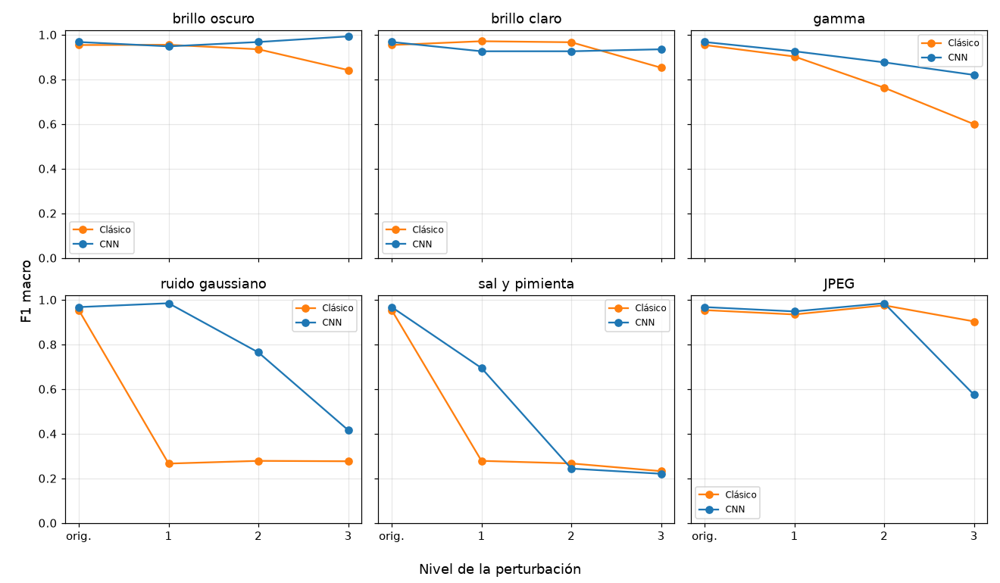
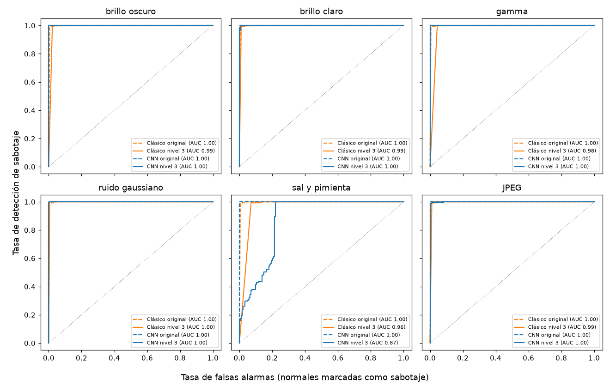

# 8. Auditoría de robustez

La guía pide enfrentar ambos sistemas a entornos degradados de forma artificial o física. Esta sección reporta la
degradación artificial del módulo clásico; la CNN, la degradación física y la prueba regional se agregan cuando
estén sus resultados.

## 8.1 Conjuntos degradados

- **Imágenes:** las 327 de prueba de la ubicación 1.
- **Perturbaciones:** 6 tipos con 3 niveles cada uno, más la original: 19 condiciones y 6213 imágenes. Los
  niveles van de leve a fuerte (tabla 8.1). Fuente: `src/perturbations.py`.
- **El desenfoque no es una perturbación:** es una clase. Una imagen normal desenfocada cambia de etiqueta con
  razón, así que no mide robustez.
- **Orden:** cada imagen se reduce primero a 640×360, el tamaño de los descriptores, y **después** se perturba.
  Si se perturbara la original (hasta 4608×2592) y luego se redujera, el ruido se promediaría y casi
  desaparecería.
- **Reproducibilidad:** las imágenes degradadas no se guardan. Cada una se regenera con una semilla fija (CRC32
  de la ruta, la perturbación y el nivel), así que la CNN se evalúa exactamente sobre las mismas imágenes
  (`src/audit.degrade`).

| Perturbación | Qué simula | Nivel 1 / 2 / 3 |
|---|---|---|
| Brillo oscuro | Anochecer o luz apagada (ganancia multiplicativa) | × 0,7 / 0,5 / 0,3 |
| Brillo claro | Contraluz o linterna | × 1,3 / 1,6 / 2,0 |
| Gamma | Sensor subexpuesto: oscurece los medios tonos | γ = 1,5 / 2 / 3 |
| Ruido gaussiano | Ruido del sensor con poca luz | σ = 5 / 15 / 30 niveles de gris |
| Sal y pimienta | Píxeles muertos o errores de transmisión | 1 % / 5 % / 10 % de los píxeles |
| JPEG | Compresión del video en la red | Calidad 60 / 30 / 10 |

**Tabla 8.1.** Perturbaciones y niveles.

## 8.2 Resultados del módulo clásico

**Tabla 8.2.** Módulo clásico en cada condición. Las predicciones son el número de imágenes asignadas a cada clase;
la distribución real es siempre 182 normales, 68 desenfocadas, 9 giradas y 68 tapadas. Fuente:
`results/auditoria/tabla.csv`.

| Perturbación | Nivel | Intensidad | F1 macro | Falsas alarmas | AUC | Predichas normal / desenfocada / girada / tapada |
|---|---|---|---|---|---|---|
| Original | — | — | 0,954 | 0,5 % | 0,997 | 183 / 68 / 8 / 68 |
| Brillo oscuro | 1 | × 0,7 | 0,955 | 1,6 % | 0,997 | 179 / 70 / 12 / 66 |
| Brillo oscuro | 2 | × 0,5 | 0,935 | 2,7 % | 0,997 | 177 / 70 / 14 / 66 |
| Brillo oscuro | 3 | × 0,3 | 0,842 | 2,7 % | 0,989 | 177 / 73 / 9 / 68 |
| Brillo claro | 1 | × 1,3 | 0,971 | 0,5 % | 0,997 | 182 / 68 / 9 / 68 |
| Brillo claro | 2 | × 1,6 | 0,966 | 1,1 % | 0,997 | 180 / 66 / 11 / 70 |
| Brillo claro | 3 | × 2,0 | 0,852 | 5,5 % | 0,994 | 172 / 66 / 19 / 70 |
| Gamma | 1 | γ = 1,5 | 0,902 | 1,1 % | 0,997 | 180 / 87 / 11 / 49 |
| Gamma | 2 | γ = 2 | 0,762 | 3,3 % | 0,995 | 176 / 108 / 14 / 29 |
| Gamma | 3 | γ = 3 | 0,599 | 18,7 % | 0,978 | 148 / 132 / 21 / 26 |
| Ruido gaussiano | 1 | σ = 5 | 0,266 | 1,1 % | 0,997 | 183 / 0 / 144 / 0 |
| Ruido gaussiano | 2 | σ = 15 | 0,278 | 0,5 % | 0,997 | 181 / 0 / 146 / 0 |
| Ruido gaussiano | 3 | σ = 30 | 0,277 | 1,6 % | 0,997 | 179 / 0 / 148 / 0 |
| Sal y pimienta | 1 | 1 % | 0,278 | 0,5 % | 0,997 | 181 / 0 / 146 / 0 |
| Sal y pimienta | 2 | 5 % | 0,267 | 7,7 % | 0,992 | 168 / 0 / 159 / 0 |
| Sal y pimienta | 3 | 10 % | 0,232 | 27,5 % | 0,964 | 132 / 0 / 195 / 0 |
| JPEG | 1 | calidad 60 | 0,934 | 1,1 % | 0,997 | 182 / 66 / 9 / 70 |
| JPEG | 2 | calidad 30 | 0,975 | 0,5 % | 0,997 | 181 / 67 / 10 / 69 |
| JPEG | 3 | calidad 10 | 0,903 | 2,2 % | 0,995 | 178 / 68 / 16 / 65 |

La condición original reproduce exactamente el resultado de prueba de la sección 7 (F1 0,954), lo que confirma
que el procedimiento de degradación no altera las imágenes cuando no hay perturbación.

## 8.3 Lectura

1. **El sistema sabe *que* hay sabotaje, pero no siempre *cuál*.** Con ruido gaussiano el F1 cae a 0,27, pero
   el AUC sigue en 0,997 y las falsas alarmas cerca del 1 %. Las normales siguen siendo normales; lo que falla
   es el tipo de sabotaje: **ninguna** imagen se predice desenfocada ni tapada, y todas pasan a girada (144 a 148
   predichas como giradas, con solo 9 giradas reales).
2. **El ruido impulsivo es el ataque más grave.** Sal y pimienta al 10 % combina los dos fallos: confunde el tipo
   de sabotaje (F1 0,23) y además dispara falsas alarmas en el 27,5 % de las normales.
3. **La oscuridad por gamma es el ataque de luz más grave.** Con γ = 3 las falsas alarmas suben al 18,7 % y las
   tapadas pasan a desenfocadas (26 predichas como tapadas de 68).
4. **El módulo resiste el brillo oscuro y la compresión JPEG.** El F1 se mantiene en 0,84 o más en todos los
   niveles, y el JPEG de calidad 10 todavía da 0,90.
5. **El tiempo por cuadro no cambia de forma relevante** (entre 6,8 y 20,6 ms según la condición): el costo está
   en los descriptores, no en la imagen.

El porqué de cada fallo, con su fórmula, y su corrección están en la sección 9.

## 8.4 CNN frente al clásico en las mismas condiciones (T71)

La CNN corre sobre **las mismas 6213 imágenes** (327 de test × 19 condiciones), con la misma degradación y la misma
semilla por imagen que el clásico (`src/audit_cnn.py`; una prueba comprueba píxel a píxel que los dos modelos ven el
mismo cuadro). La imagen degradada de 640×360 se reduce a 224×224 como en el entrenamiento. En la original la CNN da
F1 0,967, igual que en su evaluación de la sección 7 (T64), lo que confirma que el procedimiento es el mismo.

**Tabla 8.3.** F1 macro, tasa de falsas alarmas (normales marcadas como sabotaje) y AUC normal frente a sabotaje por
condición. Fuente: `results/auditoria/tabla.csv`. "Mejor F1": diferencia mayor que 0,02; si no, ≈.

| Condición | Nivel | F1 clásico | F1 CNN | Falsas alarmas clásico | Falsas alarmas CNN | AUC clásico | AUC CNN | Mejor F1 |
|---|---|---|---|---|---|---|---|---|
| Original | — | 0,954 | 0,967 | 0,5 % | 0,0 % | 0,997 | 1,000 | ≈ |
| Brillo oscuro | 1 | 0,955 | 0,948 | 1,6 % | 0,0 % | 0,997 | 1,000 | ≈ |
| Brillo oscuro | 2 | 0,935 | 0,967 | 2,7 % | 0,0 % | 0,997 | 1,000 | CNN |
| Brillo oscuro | 3 | 0,842 | 0,993 | 2,7 % | 0,0 % | 0,989 | 1,000 | CNN |
| Brillo claro | 1 | 0,971 | 0,926 | 0,5 % | 0,0 % | 0,997 | 1,000 | Clásico |
| Brillo claro | 2 | 0,966 | 0,926 | 1,1 % | 0,0 % | 0,997 | 1,000 | Clásico |
| Brillo claro | 3 | 0,852 | 0,935 | 5,5 % | 0,5 % | 0,994 | 1,000 | CNN |
| Gamma | 1 | 0,902 | 0,926 | 1,1 % | 0,0 % | 0,997 | 1,000 | CNN |
| Gamma | 2 | 0,762 | 0,876 | 3,3 % | 0,0 % | 0,995 | 1,000 | CNN |
| Gamma | 3 | 0,599 | 0,820 | 18,7 % | 0,0 % | 0,978 | 1,000 | CNN |
| Ruido gaussiano | 1 | 0,266 | 0,985 | 1,1 % | 0,0 % | 0,997 | 1,000 | CNN |
| Ruido gaussiano | 2 | 0,278 | 0,764 | 0,5 % | 0,5 % | 0,997 | 1,000 | CNN |
| Ruido gaussiano | 3 | 0,277 | 0,416 | 1,6 % | 1,1 % | 0,997 | 1,000 | CNN |
| Sal y pimienta | 1 | 0,278 | 0,694 | 0,5 % | 22,0 % | 0,997 | 0,995 | CNN |
| Sal y pimienta | 2 | 0,267 | 0,244 | 7,7 % | 25,3 % | 0,992 | 0,940 | Clásico |
| Sal y pimienta | 3 | 0,232 | 0,221 | 27,5 % | 33,5 % | 0,964 | 0,872 | ≈ |
| JPEG | 1 | 0,934 | 0,948 | 1,1 % | 0,0 % | 0,997 | 1,000 | ≈ |
| JPEG | 2 | 0,975 | 0,985 | 0,5 % | 0,0 % | 0,997 | 1,000 | ≈ |
| JPEG | 3 | 0,903 | 0,575 | 2,2 % | 0,5 % | 0,995 | 0,999 | Clásico |

Tiempo por cuadro (mediana de las 19 condiciones): clásico **12,4 ms**, CNN **51,9 ms**.

## 8.5 Lectura de la comparación (T72, T73)

**Figura 8.1.** F1 macro frente al nivel de cada perturbación. Fuente: `results/figuras/auditoria_f1_severidad.png`.

1. **Ningún modelo es más robusto en todo.** La CNN tiene mejor F1 en 10 de las 19 condiciones, el clásico en 4 y en
   5 quedan parejos. La CNN gana con la luz (gamma 3: 0,820 frente a 0,599; brillo oscuro 3: 0,993 frente a 0,842) y
   con el ruido gaussiano leve (σ = 5: 0,985 frente a 0,266). El clásico gana con la compresión JPEG fuerte (0,903
   frente a 0,575) y con el brillo claro leve (niveles 1 y 2).
2. **Los dos siguen detectando *que* hay sabotaje; fallan en *qué tipo*.** El AUC normal frente a sabotaje es
   ≥ 0,96 en 36 de las 38 combinaciones de modelo y condición. Por eso el F1, que sí mira el tipo, cae mucho más que
   el AUC. Las dos excepciones son la CNN con sal y pimienta (AUC 0,940 en el nivel 2 y 0,872 en el nivel 3).
3. **Falsas alarmas:** la CNN casi no da (≤ 1,1 %) salvo con sal y pimienta (22,0 % a 33,5 %); el clásico llega a
   18,7 % con gamma 3 y 27,5 % con sal y pimienta 3.
4. **Hacia dónde se equivocan** (matrices cruzadas, `results/figuras/auditoria_matrices.png` y
   `results/auditoria/matrices_cruzadas.csv`): los dos tienden a "girada". El clásico, con ruido, porque el Laplaciano
   inflado hace parecer nítidas las desenfocadas y tapadas (sección 9). La CNN, con sal y pimienta 3, manda a girada
   61 de 182 normales y todas las desenfocadas y tapadas; con JPEG 3, 28 de 68 desenfocadas y 50 de 68 tapadas.
5. **Costo:** la CNN tarda unas 4 veces más por cuadro, y su error no se explica con un descriptor ni se corrige con
   un filtro conocido; el del clásico sí (sección 9).

**Figura 8.2.** ROC normal frente a sabotaje por perturbación: nivel 3 (continua) frente a la original (punteada).
Fuente: `results/figuras/auditoria_roc.png`. La interpretación completa está en `notebooks/06_auditoria.ipynb`.

## 8.6 Pendiente

- **Degradación física** con luz real en la captura propia (Cristhian, T75, después de la captura T81).
- **Prueba regional en Medellín** y robustez de ORB, SIFT y KAZE ante perturbaciones (Santiago, T76 y T77). Si no
  alcanza el tiempo, se declara como limitación (sección 11).
